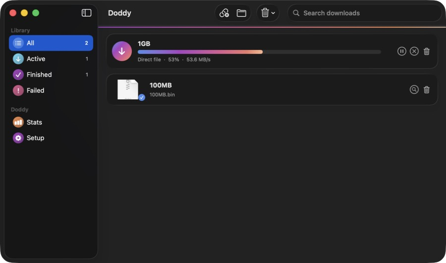
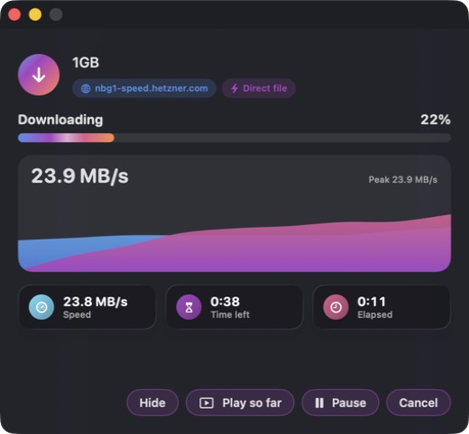
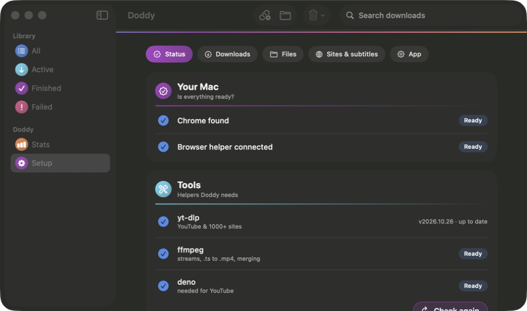

<p align="center"></p>

<h1 align="center">Doddy</h1>
<p align="center">A fast, friendly download manager for macOS, with a companion Chrome extension.</p>

<p align="center"></p>

<p align="center">
  
  
</p>

Doddy takes downloads off your browser's hands and makes them faster and harder to break. Big files are fetched over several connections at once, can be paused and resumed, and survive dropped connections and app restarts. Media streams (HLS) and pages from sites that [yt-dlp](https://github.com/yt-dlp/yt-dlp) supports are handled too.

> **Status:** personal project, version 0.2. It works well day to day, but it is not signed or notarised by Apple and the extension is not on the Chrome Web Store yet, so you build and load both yourself (steps below).

## Features

**Downloading**
- Segmented downloads (up to 8 connections per file) with pause, resume and crash recovery
- Keeps what was already downloaded after a timeout or dropped connection; retry continues where it stopped
- **Refresh link:** when a link expires, Doddy reopens the page and carries on with the new link
- Mirrors: give several addresses for one file (`link | mirror | mirror`) and the next is tried if one fails
- Native HLS stream downloader (including AES-128 encrypted streams), joined into a single MP4
- Pages from sites yt-dlp understands, with a quality picker; optional faster multi-connection mode for YouTube
- Polite to servers: when a site says "too many requests" (HTTP 429), Doddy pauses and slows down instead of hammering it

**Browser extension (Chrome, Brave, Edge, Vivaldi, Arc)**
- Optionally takes over Chrome's own downloads for chosen file types and sizes
- A Download button on media players and a list of everything detected on the page
- Link grabber: pick any set of links on a page and send them all to Doddy
- Uses your browser's identity for sites that only answer the browser (cookies are only sent when needed)

**Organising**
- Download queue with a limit on parallel downloads, a scheduler and an action when the queue ends (quit or sleep)
- Speed limit, file name templates (`{title} {site} {date} {quality}`), tidy names, sorting into folders by site or type
- Per-site rules (for example, a different save folder for a site)
- Convert after download (MP4, MP3, M4A), subtitles embedded and optionally translated to English on-device (macOS 15+)

**On your Mac**
- Live speed graph, progress windows, Dock progress and a menu bar list
- "Play so far" while a video is still downloading
- Stats, clean-up of leftover partial files, settings export and import
- A privacy-minded log: links are shortened to the site name, and cookies, tokens, e-mail and IP addresses are removed

## Requirements

- macOS 13 Ventura or newer
- Google Chrome or another Chromium browser (Brave, Edge, Vivaldi, Arc) for the extension

Doddy installs its helper tools ([yt-dlp](https://github.com/yt-dlp/yt-dlp), [ffmpeg](https://ffmpeg.org) and [Deno](https://deno.com)) into its own folder on first launch, so Homebrew is not needed.

## Install

1. Download **Doddy-0.2.0.dmg** and **Doddy-extension-0.2.0.zip** from the [latest release](https://github.com/bunduuk/doddy/releases/latest).
2. Open the disk image and drag **Doddy** into **Applications**.
3. Open Doddy. Because it is not notarised by Apple, macOS blocks it the first time: open **System Settings → Privacy & Security**, scroll down and click **Open Anyway** (or run `xattr -dr com.apple.quarantine /Applications/Doddy.app` in Terminal).
4. Unzip the extension and load it in Chrome as described in [Install the browser extension](#install-the-browser-extension).

## Build from source

Only needed if you want to change Doddy or build it yourself; the release above is ready to use.

Requirements to build:

- Xcode 26 or newer (the app icon uses Icon Composer)
- Python 3, used by the build script to refresh the Xcode project (it comes with Xcode's command-line tools, so there is nothing extra to install)

```bash
git clone https://github.com/bunduuk/doddy.git
cd doddy
./tools/build.sh
```

`build.sh` generates the Xcode project, builds a Release copy, installs it as `/Applications/Doddy.app` and opens it. To work in Xcode instead, run `python3 tools/genproj.py` once and open `Doddy.xcodeproj`.

`./tools/package.sh` does the same and also puts a disk image and the extension zip in `dist/`, ready to share. Because the app is not notarised, another Mac will block it the first time: right-click the app and choose **Open**, or run `xattr -dr com.apple.quarantine /Applications/Doddy.app`.

## Install the browser extension

1. Open Doddy once, so it registers its browser helper.
2. In Chrome, go to `chrome://extensions` and switch on **Developer mode**.
3. Click **Load unpacked** and choose the unzipped `Doddy extension` folder from the release, or the `extension` folder if you built from source (Doddy's **Setup** page has a button that shows it).
4. Back in Doddy, the setup tour shows the extension as connected after its first message.

## How it fits together

```
Chrome extension  ──native messaging──▶  Doddy (helper mode)  ──files in Application Support──▶  Doddy app
                                                                                                    │
                                     direct files · HLS streams · yt-dlp · ffmpeg  ◀────────────────┘
```

| Folder | What is in it |
| --- | --- |
| `Doddy/` | The SwiftUI app (download engine, HLS, yt-dlp integration, UI) |
| `extension/` | The Chrome extension (Manifest V3) |
| `tools/` | Build, packaging, project and icon scripts |
| `IconComposer/` | The app icon source |

Doddy's data lives in `~/Library/Application Support/Doddy`, its log in `~/Library/Logs/doddy.log`, and downloads go to `~/Downloads/Doddy` unless you choose another folder.

## Responsible use

Doddy is a general-purpose download manager. It does not remove DRM or other copy protection: protected (DRM) streams are recognised and refused. You are responsible for making sure you have the right to download what you download, and for following each site's terms.

## Licence

[MIT](LICENSE) © 2026 bunduuk
